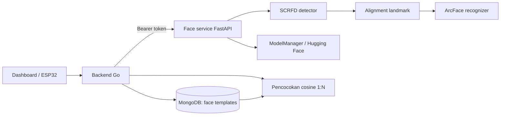
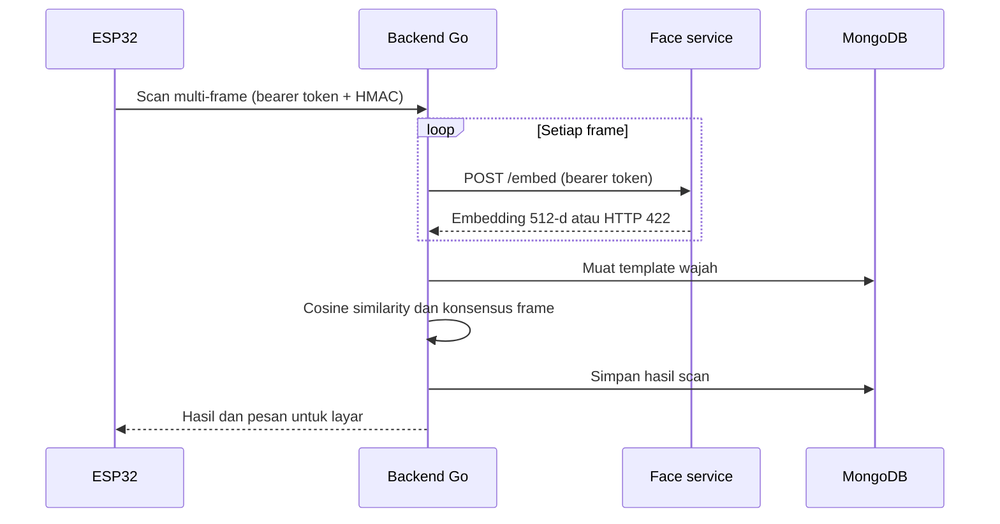

# Alur Face Service

Dokumen ini menjelaskan pembagian tanggung jawab antara layanan Python dan
backend Go pada sistem absensi wajah. Untuk deployment dan variabel
konfigurasi, lihat [README.md](README.md) dan
[../../docs/face-service.md](../../docs/face-service.md).

## 1. Arsitektur

Layanan Python memakai FastAPI dan ONNX Runtime. Pipeline menggunakan SCRFD
untuk mendeteksi wajah, landmark lima titik untuk alignment, dan ArcFace
untuk menghasilkan embedding 512 dimensi.

Face service bersifat stateless: tidak tersambung ke MongoDB dan tidak
menyimpan template. Backend Go menyimpan embedding, mencocokkan wajah
terhadap seluruh template, dan menentukan hasil absensi. Browser dan
perangkat hanya berkomunikasi dengan Go.

## 2. Startup dan Autentikasi

Saat startup, aplikasi memvalidasi `FACE_SERVICE_TOKEN`, menyiapkan model
deteksi dan pengenalan, lalu memuat pipeline ONNX. Model yang belum tersedia
dapat diunduh oleh `ModelManager` dari Hugging Face. Container Compose
menyimpan cache model pada volume agar tetap tersedia setelah restart.

Semua endpoint FastAPI memerlukan
`Authorization: Bearer <FACE_SERVICE_TOKEN>`. Token minimal 32 karakter
diwajibkan saat startup dan dibandingkan secara waktu-konstan. Go mengirim
token tersebut untuk health check, embedding, enrollment, dan manajemen model.
OpenAPI, Swagger, ReDoc, serta CORS publik dinonaktifkan. Face service tetap
harus berada pada loopback atau jaringan privat; jangan ekspos port-nya ke
jaringan publik.

## 3. Pemrosesan Gambar

1. Endpoint mendekode gambar menjadi citra BGR.
2. SCRFD memproses citra, menghasilkan bounding box, confidence, dan bila
   tersedia landmark wajah lima titik.
3. Aligner memetakan landmark ke koordinat kanonis ArcFace 112 × 112. Bila
   landmark tidak tersedia, pipeline menggunakan alignment berbasis bounding
   box.
4. ArcFace menghasilkan embedding; API mengembalikan vektor tersebut kepada
   Go. Jika tidak ada wajah, endpoint mengembalikan HTTP 422.

Untuk satu gambar dengan beberapa wajah, endpoint `/embed` dan `/register`
memilih wajah dengan confidence tertinggi. Pastikan foto enrollment hanya
memuat mahasiswa yang dimaksud.

## 4. Endpoint Internal

| Endpoint | Tujuan |
| --- | --- |
| `GET /health` | Status kesiapan dan model aktif; tetap memerlukan bearer token |
| `POST /embed` | Memproses satu gambar scan dan mengembalikan satu embedding |
| `POST /register` | Memproses 1–6 foto enrollment dan mengembalikan satu embedding per foto |
| `GET /models` | Melihat katalog dan status model lokal/remote |
| `POST /models/download` | Mengunduh model yang dipilih |
| `POST /models/switch` | Mengganti model deteksi atau pengenalan yang aktif |

Endpoint model hanya diekspos melalui backend Go dan otorisasi administrator.
Layanan Python bukan API untuk browser atau perangkat.

## 5. Enrollment Mahasiswa

Administrator mengirim 1–6 foto melalui backend Go. Go meneruskan berkas ke
`POST /register` dengan `student_id` dan menyimpan hasilnya di MongoDB.
Layanan Python mengembalikan `num_templates`, daftar embedding dan confidence,
serta waktu pemrosesan; embedding tidak disimpan di layanan Python.

Go memvalidasi bahwa wajah pada foto enrollment konsisten, memeriksa duplikasi
terhadap mahasiswa lain, dan menyimpan seluruh pose dalam satu dokumen
`face_templates`. Jika konfigurasi S3 aktif, Go juga dapat menyimpan foto asli
ke Garage. Enrollment ulang mengganti template pose sebelumnya.

Untuk mempercepat enrollment multi-foto, Go mengirim satu request per foto
secara paralel. Python memindahkan inferensi ONNX ke worker thread dan
membatasi inferensi bersamaan menjadi dua; unggahan lebih dari dua foto
diproses dalam beberapa gelombang. Endpoint `/register` tetap mendukung batch
1–6 foto untuk klien lain.

## 6. Verifikasi Scan

Go memproses frame satu per satu, mengabaikan frame tanpa wajah, lalu
membandingkan embedding dengan setiap pose yang tersimpan. Skor mahasiswa
adalah similarity tertinggi dari seluruh posenya. Status absensi ditentukan
oleh ambang `FACE_SIM_THRESHOLD` dan konsensus
`SCAN_MIN_MATCH_FRAMES`; layanan Python tidak menentukan identitas mahasiswa.

Konsensus beberapa frame bukan liveness detection. Foto atau video replay
masih dapat lolos dan perlu ditangani sebagai risiko terpisah.

## 7. Pergantian Model

Administrator dapat melihat katalog, mengunduh, dan mengganti model melalui
API Go `/api/v1/face/models*`. Model recognition baru menghasilkan ruang
embedding yang berbeda; template mahasiswa yang sudah ada tidak dijamin
sebanding dan harus di-enroll ulang sebelum scan menggunakan model baru.

## 8. Batasan dan Penanganan Galat

- `422` karena wajah tidak terdeteksi diterjemahkan Go menjadi pesan scan atau
  enrollment yang sesuai.
- Kegagalan layanan, model yang belum siap, dan timeout menghasilkan
  `face_service_error`; scan tidak dicatat sebagai keberhasilan.
- Ambang similarity belum otomatis dikalibrasi untuk lingkungan kampus.
- Face service memproses citra; pastikan pengumpulan, akses, retensi, dan
  penghapusan data biometrik mengikuti kebijakan institusi.
